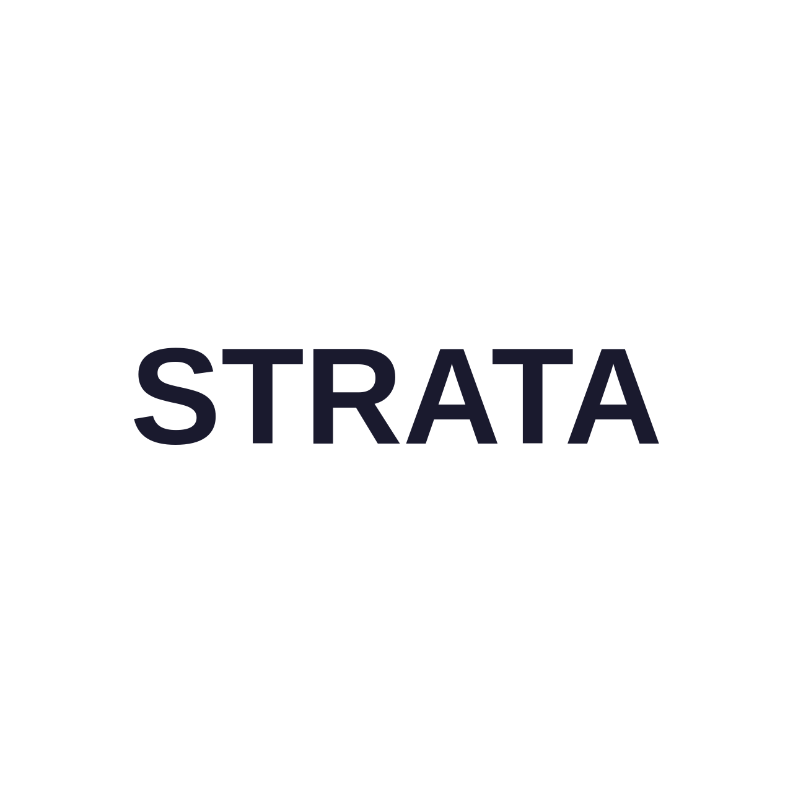
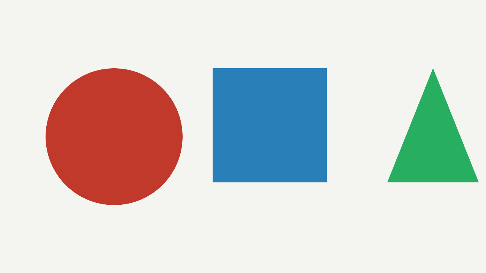
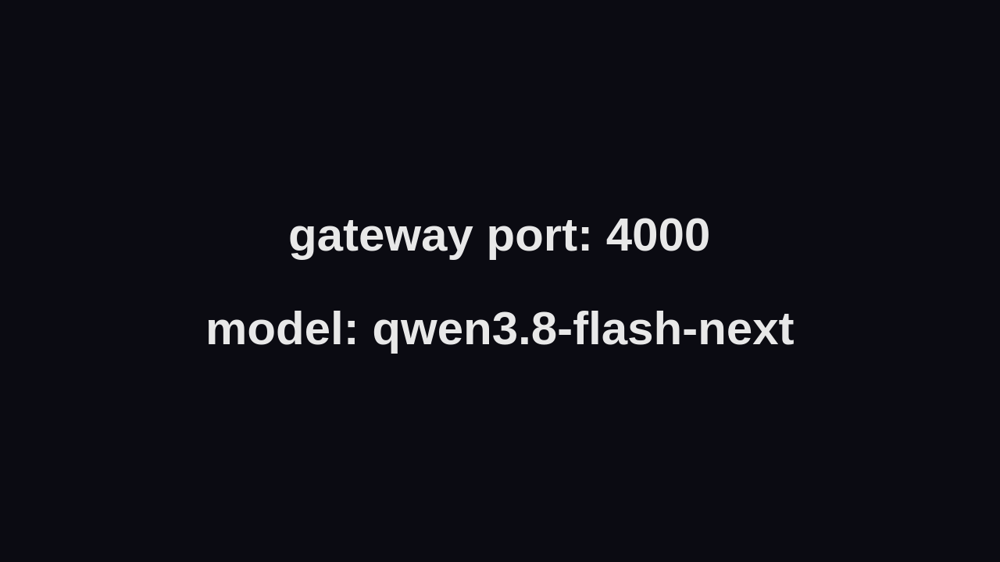

# Strata report — Swift 1.5 IQ2_XS on the desktop (RTX 5070 Ti 16GB)

**Date:** 2026-10-18 · **Host:** desktop (`dmitrii`), Fedora Atomic (SELinux Enforcing),
rootless podman 5.8.4 / podman-compose 1.6.0 · **Engine:** Strata v0.1.45
(`ai/Strata` @ `477ac13`), built locally with `CUDA_ARCHITECTURES=120`

First real run of the desktop Strata tier: the rollout from `ai/strata_plan.md` Section B,
the first-boot checks, a behaviour pass (startup, memory, gateway) and the first benchmark
numbers for `qwen3.8-flash-next`.

**Headline:** `qwen3.8-flash-next` serves a 125B-A6B MoE at **113.5 t/s deep decode** and
**~2 040 t/s prefill** on a 16GB card, with tools 4/4, quality 4/4, a 50K-token needle, and
working vision on real 1280px images — about **3× the laptop's main agent model** (deep
35.0 t/s) on the same gateway contract. Arena 33.0 GiB of the 40 GiB pin, warm restart 20 s.

## 1. What was deployed

| | |
|---|---|
| Engine | Strata v0.1.45, built from the `ai/Strata` submodule at `477ac13` |
| Model | `qwen3.8-flash-next` = **Swift 1.5 IQ2_XS** (`ukisai/Swift-1.5-Qwen3.8-Flash-Next-GSQ-RCO-GGUF`), family `swift` |
| Weights | `Swift-…-IQ2_XS-00001-of-00002.gguf` 38 GB, `…-00002-of-00002.gguf` 27 GB, `mmproj-Swift-Qwen3.8-Flash-Next-BF16.gguf` 866 MB — all three **SHA256-verified** against the repo's `SHA256SUMS` |
| Vision | `VISION=cpu` — the encoder runs as a separate `strata-vision` process (18 threads) |
| Context / KV | 131072 / `k8v4` (`--kv-resident 32768`) |
| Arena | `STRATA_ARENA_PIN_GIB=40` (measured arena 33.0 GiB) |
| Speculative | MTP draft (`--spec 4`, `--spec-min-p 0.5`); the ~5.2 GB draft is fetched at first boot from the base Qwen checkpoint into `/data/mtp` |
| Data | `${STRATA_DATA_DIR:-/var/mnt/data/llama/strata}` → `/data:z` (8 GB: pack 1.5 GB, MTP 6.5 GB) |
| Gateway | LiteLLM `:4000` → `http://strata:8080/v1`, model `qwen3.8-flash-next` |

Hardware: RTX 5070 Ti 16 GB (`card1`, `10DE:2C05`) is the inference GPU; the 7900 XTX
(`card0`, `1002:744C`) is display-only. Driver 610.57.04, i9-10980XE (18c/36t, AVX2),
94 GB RAM, PCIe 3.0 x16. Setup detected both cards and picked the NVIDIA one on its own —
it never touched the AMD card.

## 2. Rollout log

| Step | Result |
|---|---|
| B1 submodule | `ai/Strata` was **uninitialised** on this host; `git submodule update --init --checkout` → `477ac13` (v0.1.45) |
| B2 weights | `hf download`, 65 GB, original filenames; base ISTA shards, `Q2_0` and any MTP file deliberately not fetched. ⚠️ the plan's `--include "*IQ2_XS*"` also matches evaluation JSON/text files — use `"…-IQ2_XS-*.gguf"` |
| B3 data dir | already created by the user; the `sudo mkdir`/`chown` step was not needed |
| B4 build | `podman-compose -f ai/llama-cpp.yml --profile server build strata` — ≈25 min, `-j 18` on 36 threads |
| B4 start | `up -d` with `LLAMA_MODELS_DIR` / `STRATA_DATA_DIR` set |
| B7 cleanup | `podman volume rm ollama open-webui` — the only retired volumes left; n8n `*.yml` no longer exist, `litellm_postgres` kept |

Repo changes made during the rollout (all committed):

| commit | change |
|---|---|
| `38db881` | canonical `/var/mnt/data` paths in the runbook, README, AGENTS, compose |
| `2d340f0` | `/data` mount labelled `:z` + `${STRATA_DATA_DIR:-/var/mnt/data/llama/strata}` |
| `da28750` | `STRATA_ALLOWED_HOSTS=strata`; corrected the arena check from `VmLck` to `/metrics` |

## 3. Startup behaviour

**First boot** (`up -d` → serving): ≈6.5 minutes, in three phases.

1. **Pack prep** (~1.5 min) — `iq_pack.py` read the two shards: 1079 tensors, 302 served
   natively, 96 converted, tokenizer vocab 248320. The pack is only **1.5 GB** on disk: the
   experts are not copied, the engine reads them from the original GGUF (`--native`).
2. **MTP draft** (~5 min) — 31 tensors, 5.214 GB BF16 fetched from the base Qwen
   checkpoint, then packed to `mtp-q2_0.gguf` (848 MB).
3. **Load** — `experts loaded: 33.02 GiB at 3.20 GiB/s (25 s)`, then
   `filling the GPU's expert cache (7136 experts, 9.56 GiB of VRAM)`, then `ready:`.

**Warm restart** (`podman restart strata`, config already on the volume): **20 s wall**
(22:22:31 → 22:22:51), experts at **10.18 GiB/s in 14 s**, GPU cache refilled, `ready:`.
A desktop reboot is therefore a ~20-second outage, not a minutes-long one. LiteLLM needs its
own 30-60 s on top.

The log is honest about the load — `[strata] still starting (23 s)`, `almost ready …` — so
"minutes of logged silence" from the plan is really "minutes of *progress* logging" now.

## 4. Resource behaviour

| metric | value |
|---|---|
| Arena | `arena_mib: 33812` = **33.0 GiB**, comfortably under the 40 GiB pin → **the pin is a ceiling, not the working size** |
| GPU expert cache | `expert_cache_mib: 9775` (9775 MiB), `expert_slots: 7127`, `vram_free_mib: 418` |
| GPU total | 15 986 MiB used of 16 303 MiB (~98%) at idle |
| Container cgroup | 41.7 GB peak (`strata`), host RAM 51.7 / 94 GiB used |
| zram swap | 8 GB device, **3 GB in use** — the desktop is under real memory pressure, but Swap on the engine process stayed 0 |
| Idle power / temp | 17 W, 44 °C |

**The arena is NOT `mlock`-pinned** in this build. `VmLck: 0` and `smaps_rollup Locked: 0`
while the engine holds 36.3 GB of *anonymous* RSS: the pin is
`cudaHostRegister(... cudaHostRegisterPortable | cudaHostRegisterMapped)`
(`src/core/pinned.cu:423`), which the kernel does not report as a lock. **The plan's B5
arena probe (`grep VmLck ≈ 36-40 GiB`) cannot work on v0.1.45** — `curl :8080/metrics | jq
.engine.arena_mib` is the correct check.

`418 MiB` of VRAM free is thin, but it is *by design*: `--vram-reserve-mib 700` plus the
vision encoder on the CPU means an image turn needs no GPU encoder buffer. Verified with
real 1280px images (§7).

## 5. First-boot checks (plan B5)

| # | check | result |
|---|---|---|
| 1 | `/health` | ✅ `{"status":"ok","model":"swift-1.5-iq2_xs","loaded":true,"images":true}` |
| 2 | GPU wiring | ✅ `GPU: GPU 0 (NVIDIA GeForce RTX 5070 Ti, 16 GB)`; expert cache 9.56 GiB in VRAM |
| 3 | Arena | ✅ 33.0 GiB via `/metrics`; ⚠️ `VmLck` reads 0 (see §4) |
| 4 | Model id | ✅ Strata advertises `swift-1.5-iq2_xs`; the gateway keeps `qwen3.8-flash-next` and Strata accepts the forwarded name |
| 5 | Gateway | ✅ liveliness + real completion (after three fixes, §8) |

## 6. Benchmarks — `~/Projects/llm-benchmarking`

`smoke.py --profile desktop`: **all checks passed in 2.3 s** (tier, gateway alias, vision,
`max_tokens=16` approval shape → `APPROVE`). Note the harness needed a small change: its
`TIERS`/aliases were laptop-only, so `smoke.py` now carries per-machine `PROFILES`
(`--profile auto|laptop|desktop`, auto-probing `:8081` then `:8080`) —
commit `4f5dbf8` in `llm-benchmarking`.

### Throughput — direct to Strata (`:8080/v1`), `--tests all --rounds 3`

| model | prefill | decode | **deep** | acc s/d | tools | quality | think | approval |
|---|---|---|---|---|---|---|---|---|
| `qwen3.8-flash-next` | **2036 t/s** | **111.7 t/s** | **113.5 t/s** | 53%/71% | 4/4 | 4/4 | on | PASS |

Per round: prefill 2036 / 2055 / 2036 t/s — **flat, so prompt caching is not flattering the
number** (the usual single-model artifact would make rounds 2+ collapse). Deep
116.6 / 113.5 / 104.5 t/s, i.e. the third round drifts ~10% (thermal/session noise — the
harness rule "only compare within a session" applies).

- `tools` — 4/4 (`single`, `select`, `roundtrip`, `no_tool`)
- `quality` — 4/4: arithmetic `68`, `extract_json` `{"port": 5432}`, `classify` `BUG`,
  **`terse_title` pass** (the case that has failed on other tiers)
- `thinking` — 406 reasoning chars, content non-empty, no leakage
- `approval` — `APPROVE`, **0 reasoning chars**, `finish: stop` within 16 tokens →
  the `reasoning_effort: none` path and the LiteLLM `allowed_openai_params` allowlist work
- `longctx` — needle found in **49 998 tokens**, prefill **2392 t/s**, **20.9 s**
- `vision` — `yes` (1×1 PNG)

### Through the gateway (`:4000/v1`), same suite, `--rounds 2`

| model | prefill | decode | **deep** | acc s/d | tools | quality |
|---|---|---|---|---|---|---|
| `qwen3.8-flash-next` | 2039 t/s | 110.2 t/s | 111.8 t/s | 51%/68% | 4/4 | 4/4 |

**LiteLLM costs nothing measurable** (deep 111.8 vs 113.5 t/s direct, inside round-to-round
drift). Raw JSON: `strata-llmbench-direct.json`, `strata-llmbench-gateway.json`.

### Engine-side totals for the whole session

42 requests, 99 953 prompt tokens, 5 224 output tokens, **drafts offered 4678 / accepted
3027 = 64.7%**. Short single turns ran **96-154 t/s** with an **expert-cache hit of
82.8-91.2%** and only +2.5-5.1% of routed experts coming over PCIe — the tiered design is
working as intended (hot experts in the 9.5 GiB VRAM cache, the rest from the 33 GiB
arena behind PCIe 3.0).

## 7. Vision — real images

The stack's own rule is that `vision: yes` from the harness (a 1×1 PNG) only proves the
projector is wired. These are 1280px images with actual content, sent through the gateway:

| image | prompt | answer | latency | prompt tokens |
|---|---|---|---|---|
| `img/word-1280.png` | "What single word is shown?" | **`STRATA`** ✅ | 3.18 s | 358 |
| `img/shapes-1280.png` | "Describe each shape left to right" | **`Red circle / Blue square / Green triangle`** ✅ | 3.17 s | 349 |
| `img/textcard-1280.png` | "Transcribe all text exactly" | **`gateway port: 4000` / `model: qwen3.8-flash-next`** ✅ | 3.02 s | 346 |







All three correct, ~3 s per image turn (the encoder is on the CPU, and the GPU is not
disturbed). Raw results: `strata-vision-images.json`.

## 8. Findings — what actually broke, and the fixes

### 8.1 GPU access: the `base_nvidia` block works; raw CDI does not

Proven before first boot with a throwaway container. On this host
`podman run --device nvidia.com/gpu=all …` injects the nodes but **SELinux Enforcing denies
`stat` on them** from inside the container (`Permission denied` on `/dev/nvidia0`).
The repo's existing `extends: base_nvidia` block is fine as-is: podman-compose 1.6.0 turns
`deploy.resources.reservations.devices` into explicit `--device` mounts **and adds
`security-opt label=disable` itself** (`Devices=[nvidia-uvm, nvidia-uvm-tools, nvidiactl,
nvidia0, card1, renderD129]`, `SecurityOpt=[label=disable]`). **The documented CDI fallback
was not needed** — the opposite of the usual advice.

### 8.2 The `/data` mount needed a SELinux `:z` label (user-reported)

The data bind had no label, so on an Enforcing host the container cannot write the pack,
MTP draft or checksum markers. Both Strata mounts now carry `:z`, and the data dir is
`${STRATA_DATA_DIR:-/var/mnt/data/llama/strata}` (commit `2d340f0`). After the change the
directory is labelled `container_file_t` and setup writes cleanly.

### 8.3 DNS-rebinding protection rejects the compose hostname

`litellm → http://strata:8080/v1` failed with
`403 Host 'strata:8080' is not allowed (DNS rebinding protection)`. Strata answers only to
names it knows (loopback, hostname, LAN addresses). Fixed with
**`STRATA_ALLOWED_HOSTS=strata`** in the compose env (a port is dropped by the matcher, so
the bare name is right). `allowed_hosts` in the generated config or an API key would also
work; the env var is the smaller change and keeps `:8080` keyless.

### 8.4 A three-month-old `litellm:main-latest` broke the upstream hop

After 8.3 the gateway answered `500 … OpenAIException - Connection error` after ~34 s
(underlying `httpx.ConnectError`), while the same `strata:8080` returned `200` to both
`urllib` and `httpx` **from inside the LiteLLM container**. `podman pull
ghcr.io/berriai/litellm:main-latest` (the local copy was 3 months old; the pulled one
25 hours) + `--force-recreate litellm_server` fixed it with no config change. Recorded in
`ai/AGENTS.md`: **when the gateway alone fails and the upstream is provably reachable,
refresh the image before debugging the network.** Consider pinning a dated LiteLLM tag
instead of `main-latest`.

### 8.5 The `VmLck` arena probe is invalid (see §4)

Doc corrected in README/AGENTS.

### 8.6 The advertised model id is not the gateway name

`/v1/models` says `swift-1.5-iq2_xs`; the gateway name is `qwen3.8-flash-next` and Strata
accepts the forwarded name (verified both names direct, both `200 PONG`). No change needed —
the README checklist was updated so nobody "fixes" it by renaming the LiteLLM entry.

### 8.7 Minor: the image's HEALTHCHECK is dropped

`podman build` warns `HEALTHCHECK is not supported for OCI image format and will be
ignored`. With `restart: unless-stopped` there is no health-based recycle, so a wedged
engine stays up. A `healthcheck:` in the compose service (podman honours those) is the
follow-up if automatic recycling is wanted.

### 8.8 The 40 GiB pin is not binding

`arena_mib` is 33.0 GiB for IQ2_XS, so the contract's headroom is real: the documented
IQ3_XXS step (arena ~42.9 GiB → pin 44) would still fit the ≤48 GB rule, and the pin has
~7 GiB of slack at IQ2_XS.

## 9. Reproduce

```bash
cd ~/Projects/dockerfiles
git pull --ff-only && git submodule update --init --checkout ai/Strata

export LLAMA_MODELS_DIR=/var/mnt/data/llama/models
export STRATA_DATA_DIR=/var/mnt/data/llama/strata
cd "$LLAMA_MODELS_DIR"
hf download ukisai/Swift-1.5-Qwen3.8-Flash-Next-GSQ-RCO-GGUF \
  --include "Swift-Qwen3.8-Flash-Next-GSQ-RCO-IQ2_XS-*.gguf" \
  --include "mmproj-Swift-Qwen3.8-Flash-Next-BF16.gguf" --local-dir .

cd ~/Projects/dockerfiles
podman-compose -f ai/llama-cpp.yml --profile server build strata
podman-compose -f ai/llama-cpp.yml --profile server up -d

curl -s 127.0.0.1:8080/health
curl -s 127.0.0.1:8080/metrics | jq '.engine.arena_mib'      # ~33812

cd ~/Projects/llm-benchmarking
export LITELLM_ENV=~/Projects/dockerfiles/ai/litellm.env
./smoke.py --profile desktop
./llmbench.py --models qwen3.8-flash-next --endpoint http://127.0.0.1:8080/v1 --tests all --rounds 3
python3 /tmp/opencode/vision_test.py                          # the 1280px images
```

## 10. Not tested

- **No second model on the desktop**, so the harness's alternation cannot flush the prompt
  cache — the perf caveat in §6 stands (rounds agreed here, so it did not bite).
- No sustained-load/thermal soak, no multi-hour session, no measure of the *quality* of
  long agent turns (only the harness's four quality cases and a 50K needle).
- The Swift `IQ3_XXS` step-up was **not** exercised (documented worst case, untested).
- Hermes/opencode client pins (`~/.hermes/config.yaml`, `~/.config/opencode/opencode.json`)
  are still the deferred B8 work.

---

## Addendum (2026-10-19): context raised to 262144

One reinstall pass (`CONTEXT=262144` + `STRATA_REINSTALL=1`, config/MTP/pack reused), ready
in 30 s. `/v1/status`: native and `max_positions` **262144**; `/health` `max_context: 262144`.

The prediction held exactly — the window costs RAM, not VRAM:

| | 131072 | 262144 |
|---|---|---|
| `arena_mib` | 33 812 | **33 812 (unchanged)** |
| `expert_cache_mib` / `vram_free_mib` | 9 775 / 418 | 9 543 / 418 |
| KV total (RAM, pinned) | 1.29 GiB | 2.59 GiB |

**Throughput at ~8.6K is unchanged**: prefill 2041 t/s, decode 109.9, deep **107.4 t/s**
(131K run: 2036 / 111.7 / 113.5 — the difference is inside the ±10% round spread), tools
4/4, quality 4/4, approval PASS.

**Deep-window behaviour is the interesting part.** Two needle runs, numbers from the
engine log (see the caveat below):

| prompt | read | needle | decode at depth | expert-cache hit |
|---|---|---|---|---|
| 120 895 tokens | ~45 s | found ✅ | 119.7-147.7 t/s | 83.8% |
| **197 451 tokens** | **61 s (~3 230 t/s effective)** | found ✅ | **132.1-156.3 t/s** | **95.5%** |

Decode did **not** collapse at 197K — it improved with the cache hit rate, and only 0.1% of
routed experts came over PCIe at that depth. The 40 GiB pin was not approached: this is a
131K→262K raise with no measurable cost at the short end.

**Harness caveat found in the process:** `llmbench.py`'s `ctx_tokens` and `prefill_tps` come
from the response's `timings` object and **under-report on Strata** — it reported
`104 516 tokens / 2 326 t/s` and `131 915 / 2 159 t/s` where the engine read `120 895` and
`197 451`. Use the engine log for Strata long-context numbers; the harness's
`found`/`empty` verdicts stay reliable.

Host after the deep runs: RAM 54/93 GiB used, zram 4.7 GB data (the long prompts pushed
swap, which the pinned arena/KV cannot use). Gateway still `PONG` in 0.6 s.

Client-side follow-ups: the desktop's Hermes pin belongs at **262144** now; the laptop's
remote `qwen3.8-flash-next` entry and the homelab hop were bumped in the same change
(`f6cb935`, homelab `52b16ac`), and the laptop's two dead `server-qwen3.*` entries were
removed — which makes the laptop's `~/.hermes/config.yaml` rewiring urgent rather than
deferred.
